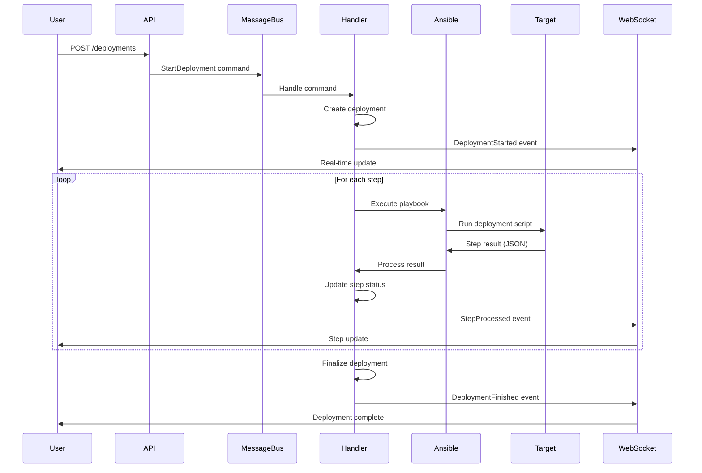
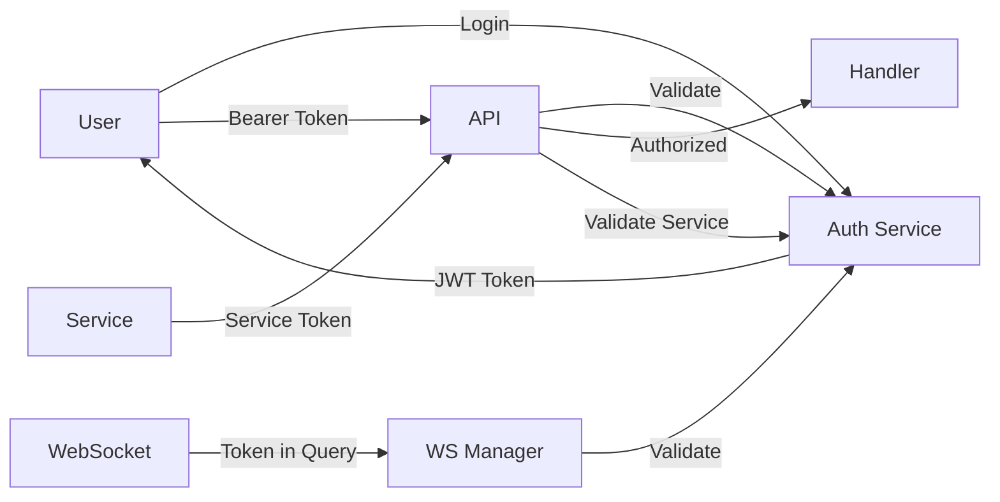

# fastDeploy Architecture

## Overview

fastDeploy is a deployment automation platform built with modern software architecture patterns that enable both technical and non-technical users to deploy web applications reliably and efficiently. The system follows Domain-Driven Design (DDD) principles, implements event-driven architecture patterns, and maintains a clean separation of concerns across all layers.

## System Architecture

### High-Level Design

fastDeploy follows a **Hexagonal Architecture** (Ports and Adapters) pattern, organizing code into distinct layers with clear boundaries and dependencies that flow inward:

```mermaid
graph TB
    subgraph "External Layer"
        WEB[Web UI - Vue.js]
        API[REST API]
        WS[WebSocket]
        CLI[CLI Tools]
    end

    subgraph "Entrypoints"
        FAST[FastAPI App]
        ROUTES[API Routes]
        WSMGR[WebSocket Manager]
    end

    subgraph "Service Layer"
        MB[Message Bus]
        HANDLERS[Command/Event Handlers]
        VIEWS[Query Views]
    end

    subgraph "Domain Layer"
        MODELS[Domain Models]
        EVENTS[Domain Events]
        COMMANDS[Commands]
    end

    subgraph "Adapters"
        REPO[Repositories]
        ORM[SQLAlchemy ORM]
        ANSIBLE[Ansible Runner]
    end

    subgraph "Infrastructure"
        DB[(PostgreSQL)]
        FS[File System]
        SSH[SSH/Ansible]
    end

    WEB --> API
    API --> FAST
    WS --> WSMGR
    CLI --> FAST
    FAST --> ROUTES
    ROUTES --> MB
    ROUTES --> VIEWS
    WSMGR --> MB
    MB --> HANDLERS
    HANDLERS --> MODELS
    HANDLERS --> REPO
    MODELS --> EVENTS
    MODELS --> COMMANDS
    REPO --> ORM
    ORM --> DB
    HANDLERS --> ANSIBLE
    ANSIBLE --> SSH
    VIEWS --> REPO
```



### Technology Stack

#### Backend Stack
- **Framework**: FastAPI - Modern async Python web framework with automatic OpenAPI documentation
- **Database**: PostgreSQL with asyncpg for high-performance async database access
- **ORM**: SQLAlchemy 2.0 with imperative mapping for clean domain model separation
- **Message Bus**: Custom async message bus for command and event handling
- **Deployment**: Ansible playbooks for infrastructure automation
- **Testing**: pytest with comprehensive async support and fixtures

#### Frontend Stack
- **Framework**: Vue.js 3 with Composition API for reactive UI components
- **Build Tool**: Vite for fast development and optimized production builds
- **State Management**: Pinia stores for centralized state management
- **Real-time**: WebSocket client for live deployment updates
- **HTTP Client**: Custom client built on mande with authentication interceptors
- **Testing**: Vitest for component and integration testing

#### Infrastructure
- **Process Management**: Justfile for task automation (migrating from Honcho)
- **Code Quality**: Ruff (linting + formatting), mypy (type checking), pre-commit hooks
- **Documentation**: MkDocs with Material theme
- **Packaging**: UV build backend for modern Python packaging

## Core Design Patterns

### Domain-Driven Design (DDD)

fastDeploy implements DDD with rich domain models that encapsulate business logic:

#### Aggregates
The domain layer contains several key aggregates, each maintaining its own consistency boundary:

- **User**: Manages authentication, tokens, and permissions
- **Service**: Defines deployable applications with their configuration
- **Deployment**: Orchestrates the deployment process and tracks state
- **Step**: Represents individual deployment actions within a deployment
- **DeployedService**: Tracks the relationship between services and their deployments

#### Domain Events
All aggregates inherit from `EventsMixin`, providing event recording capabilities:

```python
class EventsMixin:
    def record_event(self, event: Event):
        """Record a domain event for later processing"""
        self.events.append(event)
```

Events capture all significant state changes:
- `UserCreated`, `UserUpdated`, `UserDeleted`
- `ServiceCreated`, `ServiceUpdated`, `ServiceDeleted`
- `DeploymentStarted`, `DeploymentFinished`, `DeploymentFailed`
- `StepProcessed`, `StepUpdated`

### Event-Driven Architecture

#### Command-Query Responsibility Segregation (CQRS)

The system separates read and write operations:

**Commands** (Write Operations):
- `CreateUser`, `UpdateUser`, `DeleteUser`
- `CreateService`, `UpdateService`, `DeleteService`
- `StartDeployment`, `ProcessStep`, `FinishDeployment`

**Queries** (Read Operations):
- Handled through dedicated view functions
- Optimized read models for different use cases
- No side effects on domain state

#### Message Bus Pattern

`MessageBus.handle()` dispatches a command or event and drains the events
collected from the unit of work in FIFO order. Each successful handler appends
new events behind pending work; event handlers run in registration order. The
queue uses a deque with constant-time front removal, so removing all messages
from a large synchronization batch takes linear work. For
example, a command producing `first` and `second`, where handling `first`
produces `nested`, dispatches `first`, `second`, then `nested`, exactly once.

After follow-ups finish, `handle()` returns the initial command handler's result.
Event handler return values do not replace it; an initial event returns `None`.
A bus and its UOW belong to one operation at a time. A reentrant or concurrent
`handle()` call raises `RuntimeError` before touching the active queue or invoking
a handler. Use a separate bus/UOW for an independent concurrent operation. Ownership
is released on success, failure and cancellation, so sequential reuse remains valid.
A subsequent sequential call starts with its own message and no completed work
left over from the preceding successful call.

The deployment start endpoint subscribes a temporary `DeploymentStarted` handler
to capture the HTTP response data. It removes that handler when dispatch exits,
including on success, rejection or cancellation. The normal event publisher stays
registered.

Events with no registered subscribers are skipped and the queue continues draining.
An ordinary event-handler exception is logged and later handlers/events continue.
Commands require a registered handler; missing command handlers raise `KeyError`.
Command-handler exceptions propagate to the caller and abort that dispatch before
collecting its generated events; this does not promise rollback of the unit of
work's pending events.
`asyncio.CancelledError` propagates during either kind of handler await, without
running later handlers. Diagnostic message prefixes contain message type and ids,
not command/event payloads; exception tracebacks are retained.

`uv run pytest tests/unit/messagebus_dispatch_test.py` protects these existing
contracts with synthetic command/event classes and a fake unit of work. Tests
assert observable call order/results; cancellation uses synchronization events
rather than timing sleeps. The existing `messagebus_logging_test.py` separately
checks metadata diagnostic fields.

Benefits:
- Decoupled components
- Asynchronous processing
- Event cascading support
- Transaction boundary management

### Repository Pattern

Abstract repositories provide a collection-like interface for domain objects:

```python
class AbstractServiceRepository(ABC):
    @abstractmethod
    async def add(self, service: Service) -> None:
        """Add a service to the repository"""

    @abstractmethod
    async def get(self, id: int) -> Service:
        """Retrieve a service by ID"""

    @abstractmethod
    async def get_by_name(self, name: str) -> Service:
        """Retrieve a service by name"""
```

Multiple implementations support different scenarios:
- `SqlAlchemyServiceRepository`: Production persistence
- `InMemoryServiceRepository`: Testing and development
- `TestableServiceRepository`: Controlled testing scenarios

### Unit of Work Pattern

The Unit of Work pattern manages transactions and coordinates repositories:

```python
class AbstractUnitOfWork:
    async def __aenter__(self):
        return self

    async def __aexit__(self, *args):
        await self.rollback()

    async def commit(self):
        """Commit the transaction"""

    async def rollback(self):
        """Rollback the transaction"""

    def collect_new_events(self):
        """Collect events from all repositories"""
```

Features:
- Atomic operations across multiple repositories
- Automatic event collection
- Transaction lifecycle management
- Consistent error handling

### Dependency Injection

The bootstrap system provides flexible dependency injection:

```python
def bootstrap(
    use_fake_email: bool = False,
    use_in_memory: bool = False,
    use_testable: bool = False,
) -> MessageBus:
    """Configure and wire up the application dependencies"""
```

This enables:
- Environment-specific configurations
- Easy testing with mock implementations
- Clean separation of concerns
- Runtime dependency resolution

## Frontend Architecture

### Component Architecture

Vue.js components are organized by feature:

```
frontend/src/
├── components/           # Reusable UI components
│   ├── ServiceList.vue
│   ├── ServiceDetail.vue
│   ├── DeploymentList.vue
│   ├── DeploymentDetail.vue
│   └── WebsocketStatus.vue
├── stores/              # Pinia state stores
│   ├── auth.js         # Authentication state
│   ├── deployment.js   # Deployment management
│   ├── service.js      # Service management
│   └── websocket.js    # WebSocket connection
└── views/              # Page-level components
    ├── Home.vue
    ├── Login.vue
    └── Dashboard.vue
```

### State Management

Pinia stores provide centralized state management with a clean API:

```javascript
export const useDeploymentStore = defineStore('deployment', {
    state: () => ({
        deployments: [],
        currentDeployment: null,
        loading: false
    }),

    actions: {
        async fetchDeployments() {
            // Fetch deployments from API
        },

        handleWebSocketUpdate(data) {
            // Process real-time updates
        }
    }
})
```

### Real-time Communication

WebSocket integration provides live deployment updates:

```javascript
class WebSocketClient {
    connect(token) {
        this.ws = new WebSocket(`${WS_URL}?token=${token}`)
        this.ws.onmessage = this.handleMessage
    }

    handleMessage(event) {
        const data = JSON.parse(event.data)
        // Dispatch to appropriate store
    }
}
```

### Frontend transport lifetime

The Pinia auth store owns one API destination watcher. It retires the current
session and pending logins synchronously on a destination change. Pinia stops
the watcher when disposing the store and installs a new one on recreation.

The websocket activity indicator stays lit for one second after the latest admitted
message. Each status store owns one replaceable expiry timer, including during
bursts. Resetting the store (also on logout) cancels that timer; an old session
cannot expire activity in a later one.

Every frontend HTTP call has a 30-second whole-request deadline, including response
body reading and decoding. Success and error bodies additionally have a 1 MiB
streamed-byte ceiling before JSON decoding. When headers arrive for a retired
session or destination, the client cancels the response body before reading it.
It checks ownership again after decoding. Content-Length only enables early
rejection; every chunk is counted even when the header is absent or incorrect.
Overflow cancels the reader and raises a fixed, payload-free error. A private AbortController forwards caller cancellation
to fetch. Both cancellation and deadline expiry settle the call even if the
transport ignores abort; timers and caller listeners are retired on every outcome.
Expiry is reported as `TimeoutError`, caller cancellation as `AbortError` (or the
caller's supplied reason). Store loading flags and pending event fences are then
released by their existing completion paths. No request is automatically retried.
A timed-out deployment or service sync may already have reached the server: refresh
its state before deciding whether to retry.

REST JSON responses and websocket frames share `frontend/src/strictJson.ts`.
It uses the public `jsonc-parser` visitor to reject duplicate decoded object
member names at every nesting level before standard JSON decoding and typed
admission. Escaped names count as the same member; repeated names in separate
objects remain valid. Comments, trailing commas and malformed JSON are refused.
Object/array nesting deeper than 512 levels is refused the same way, so the
recursive visitor never reaches the engine stack limit.
REST refusal follows existing invalid-response feedback and retains the last good
business snapshot; ambiguous token responses cannot authenticate. Websocket refusal
sets the fixed protocol error and retires the connection without logout or retry.
Response contents never enter parser diagnostics. HTTP byte/deadline limits and
session/generation ownership checks still apply.

### REST snapshot admission

Deployment history validates every row before modifying cached data or paging
state. Pages have at most 50 unique positive safe integer ids in strictly descending
order below `before_id`, and every row must belong to `service_id` when requested.
Origin/user are strings, start is a valid ISO timestamp, finish is null or a valid
ISO timestamp, and optional deletion flags must be boolean (history rows cannot be
deleted). Only declared fields are projected. Invalid responses keep last-good
rows/cursor and expose an explicit retry; valid pages preserve intervening events.
Start responses use the same decoder and must match the service identity captured
before the launch request. Invalid success responses are ambiguous outcomes:
no row or navigation is published, and users must refresh history before retrying.
A cached terminal deployment cannot regress to unfinished through a delayed start
event. Deletion events remain effective; reconnect REST remains authoritative.

Step pages above the 25-row limit are rejected before any row is read or projected.
Step hydration builds a complete isolated snapshot. Every row needs a positive
safe integer id, the requested deployment id, string name/message, one of
`pending`, `running`, `success`, `failure`, and `started`/`finished` as null or
parseable ISO datetime strings. Duplicate ids and ids already owned by another
cached deployment reject the entire response. Only declared fields are copied;
unknown keys (including object-method names and camel-case aliases) never enter
the case/date converter. Dates are normalized before any deletion or insertion.
A rejected response leaves the step map, deployment map and scroll history intact;
the caller shows the existing retry feedback, and pending event fences are released.
Each step event is recorded in all pending snapshots for its own deployment only,
so overlapping requests preserve newer rows and deletions.

Services likewise require a complete list with unique positive safe integer ids,
string names and object (non-null, non-array) data. Available names require an
array of unique strings. Both responses are checked before publication, keep the
last good state on rejection and use fixed, payload-free request-local error
messages. Valid snapshots still preserve websocket-touched ids, including deletes.

An optional `deleted` flag on step or service rows must be a boolean, as on the
websocket. REST and websocket admission share the identifier, timestamp, step-state
and deletion predicates in `frontend/src/wireValues.ts`, so both paths keep one
wire contract.

Timestamps require real Gregorian calendar dates, including leap-year rules,
hours 00–23, minutes/seconds 00–59 and valid offset components. Impossible dates
and `24:00` are refused before conversion, rather than normalized into another
day. Supported ISO forms retain optional seconds/fractions, `Z` or numeric offsets
(`+05:30` / `-0530`), and legacy timestamps without a timezone. Naive values keep
the browser's existing local-time interpretation; fractions keep JavaScript's
millisecond conversion. Invalid dates refuse the whole REST snapshot or websocket
message without changing business data.

All admission runs after the existing session/refresh-generation ownership checks;
obsolete responses cannot publish data or failure feedback over a newer request.

Service-token issuance admits only an object with `token_type: "bearer"` and a
nonempty `service_token` string of at most 16,384 printable ASCII characters, without
spaces. Other response fields are ignored; the frontend does not
decode or verify the JWT. Invalid JSON/shapes return no token and fixed retry
feedback. Error feedback uses fixed status-based messages, never body or exception
text, so credentials cannot enter diagnostics. Session retirement is checked before
admission; detail-view request generations still discard results and feedback from
former routes. Concurrent deployment requests retain their request-local callbacks.

### Login Session

Everything the web UI holds for a logged-in user belongs to one login session and ends with it
(`frontend/src/stores/auth.ts`, `endSession`):

- The auth store keeps the websocket client of the session. Ending the session disposes it: its event
  handlers are detached, the connection is closed, and a disposed client never reconnects,
  authenticates or passes a message to a store again, also not from a reconnect timer that was already
  waiting or a connection that opens late.
- The services, deployments and steps stores and the websocket status are reset. Their HTTP clients are
  replaced by clients without `Authorization` header (`getClient()` only sets the header while an access
  token exists).
- The access token and the password are cleared. The password is also cleared after a successful login
  and removed from the login request options when the request has finished.
- The auth store counts sessions (`sessionId`). Every store action that waits for a response remembers
  the session it started in (`rememberSession()` in `frontend/src/stores/session.ts`) and drops the
  response if the session has changed meanwhile, so a late response cannot fill the stores of a
  logged-out UI or of the next user. New store actions that write a response into a store have to do
  the same.

A session ends on logout, which the UI performs when the server rejects the websocket authentication,
and before a new session starts on a successful login. A successful login therefore always begins with
empty stores, new clients and a new websocket client.

Starting a deployment (`startDeployment`) converts the response of `POST /deployments/` like every other
deployment (camel case keys, dates) and treats it as the oldest state of that deployment: a row that the
websocket or a list fetch already delivered is kept. It returns `null` when the session ended while it was
waiting; the caller then does nothing (the deploy button does not navigate to the deployment).

History hydration uses a per-request set of ids changed by websocket events, including deletions.
Those ids are skipped when the older HTTP page arrives; the sets are discarded on completion.
History pages are requested explicitly (50 rows, descending id cursor, optional service filter).
The store keeps a separate history id list and cursor so new events cannot shift the next page.
Events older than the loaded cursor update the cache without appearing across an unloaded gap;
those rows become visible when their history page is requested.
A refresh or service change increments a generation to invalidate the previous page request;
logout additionally resets paging state and invalidates every response through the session guard.

## Deployment Architecture

### Service Definition

Services are defined through JSON configuration files:

```json
{
    "name": "my-app",
    "description": "My Application",
    "deploy_script": "deploy.sh",
    "steps": [
        {"name": "prepare", "description": "Prepare environment"},
        {"name": "deploy", "description": "Deploy application"},
        {"name": "verify", "description": "Verify deployment"}
    ]
}
```

### Deployment Flow



### Deployment Execution

Deployments are executed through configurable scripts:

1. **Script Configuration**: Services define their deployment script
2. **Step Definition**: Steps can be defined in service.json or extracted from Ansible playbooks
3. **Script Execution**: Deploy script runs with deployment context
4. **Progress Reporting**: Scripts report step completion via API
5. **Status Updates**: Real-time updates sent via WebSocket

## Security Architecture

### Authentication & Authorization

#### Token Types
- **User Tokens**: JWT tokens for user authentication
- **Service Tokens**: Long-lived tokens for service-to-service communication
- **Deployment Tokens**: Short-lived tokens for deployment operations

#### Security Flow


### Authentication & Deployment Security

- No SSH keys stored in the application
- Deployment scripts receive JWT tokens for API authentication
- SSH_AUTH_SOCK environment variable passed through if available
- Relies on host system SSH configuration

## Testing Strategy

### Backend Testing

#### Test Pyramid
1. **Unit Tests**: Domain logic, pure functions
2. **Integration Tests**: Repository, database interactions
3. **E2E Tests**: API endpoints, full request cycle
4. **System Tests**: Complete deployment workflows

#### Test Infrastructure
```python
@pytest.fixture
async def uow():
    """Provide a test unit of work with in-memory repositories"""
    return InMemoryUnitOfWork()

@pytest.fixture
async def client(app):
    """Provide a test HTTP client"""
    async with AsyncClient(app=app) as client:
        yield client
```

### Frontend Testing

#### Component Testing
```javascript
describe('ServiceList', () => {
    it('displays services', async () => {
        const wrapper = mount(ServiceList, {
            props: { services: mockServices }
        })
        expect(wrapper.findAll('.service-item')).toHaveLength(3)
    })
})
```

#### Store Testing
```javascript
describe('DeploymentStore', () => {
    it('updates deployment status', () => {
        const store = useDeploymentStore()
        store.updateDeploymentStatus(deploymentId, 'completed')
        expect(store.currentDeployment.status).toBe('completed')
    })
})
```

## Performance Considerations

### Database Optimization
- One shared asyncpg engine per app lifetime; one unpooled connection per request or websocket (see Bootstrap resource ownership)
- Prepared statements for frequent queries
- Index optimization for common access patterns
- Query result caching where appropriate

### Async Processing
- Non-blocking I/O throughout the stack
- Concurrent request handling
- Background task processing
- WebSocket connection pooling

### Frontend Optimization
- Code splitting for lazy loading
- Component-level caching
- Virtual scrolling for large lists
- Optimistic UI updates

## Observability

### Metrics
- Deployment success/failure tracking in database
- Step execution status tracking
- WebSocket connection status for real-time updates

## Scalability Considerations

### Current Implementation
- Async I/O throughout the stack with FastAPI and asyncpg
- One shared engine without a connection pool, bounded by PostgreSQL `max_connections`
- WebSocket connection management
- Stateless API design allowing multiple instances

### Performance Features
- Non-blocking database operations
- Efficient query patterns with SQLAlchemy
- Async command and event processing
- Concurrent request handling

### Bootstrap resource ownership

FastAPI lifespan owns one SQLAlchemy engine and session factory. Each HTTP
request or websocket gets its own UOW, connection and session, closed at dependency
teardown. The engine uses `NullPool`: a websocket keeps its connection for its whole
lifetime, so a bounded shared pool would let open dashboards or idle unauthenticated
sockets block runner step reports and deployment starts. Concurrency is bounded by
PostgreSQL `max_connections`, as with the former engine-per-request setup. Only
lifespan shutdown disposes the engine, after draining the connection manager. Engine construction is lazy: startup neither checks connectivity nor
creates schema. Normal serving needs ordinary read/write permissions without
schema creation privileges.

Initialize the database explicitly before serving with the existing setup CLI:
`uv run python commands.py createuser` creates tables before creating the first
user. CLI/bootstrap callers retain a separate engine and their existing explicit
`create_db_and_tables` policy; successful CLI callers must close `bus.uow`.
Bootstrap closes internally allocated resources on connection, mapper, schema or
bus construction failure. A supplied UOW stays owned by its caller. Request
startup failure closes partial sessions/connections; lifespan startup failure
disposes its engine. Cleanup does not replace the initiating failure.

A UOW exit always attempts rollback. If a handler, commit or cancellation is
already failing, an ordinary rollback failure is logged once as `uow_rollback_failed` with
only its exception category (at most 100 characters); the initiating exception
continues to the caller. With no initiating failure, the rollback error propagates.
Cancellation or process-exit signals raised during rollback propagate directly.
Request teardown still attempts session and connection closure; CLI-owned UOWs
also dispose their engine.

### Step lifecycle and scroll ownership

A persisted step id identifies one lifecycle: pending → running → success/failure.
The client rejects regressions from terminal state and keeps deletion tombstones
until history eviction or session reset, across both WebSocket events and REST refreshes. A legitimate
rerun creates a fresh step id (possibly with the same name); ids are never reused.
Scroll metadata retains only the five most recent steps observed running, including
their completions, so the fifth entry remains the scroll target. Deletion removes
a candidate; terminal/deleted deployment events retire this metadata for that
retained history. Inactive histories and their markers follow the retention budgets below.


### Step inventory paging

Step hydration reads descending id pages of 25 rows with an exclusive `before_id`
cursor. It stages and validates pages within the traversal budgets below before
publishing or removing cached rows;
a short/empty page sets `inventoryComplete[deploymentId]`. Failed, invalid or obsolete
traversals leave the previous inventory intact and completion false. Session reset
clears this state. One event fence spans the whole traversal, so intervening live
updates/deletions win even when their row appears on a later page. Terminal/deletion
lifecycle guards also apply to subsequent completed REST traversals. The API checks
deployment existence without loading its entire step collection. Internal runner and
reconciliation reads retain their existing full-inventory behavior.

### Unit of work cleanup ownership

The SQLAlchemy UoW always attempts rollback after detaching rows, including when
`expunge_all` raises. A body error or cancellation remains primary; otherwise the
expunge error is primary. Ordinary cleanup failures while unwinding are logged only
as bounded exception categories without messages or tracebacks. Cancellation raised
by rollback keeps the base UoW's existing propagation semantics. Leaving a transaction
does not close caller-owned sessions, connections or engines: request/explicit close
owns those resources and can settle them after a failed unwind. Shared engines are
never disposed by a non-owning request UoW.

A complete step inventory is staged under one 30-second deadline, at most 1,000
rows and 8 MiB of cumulative response bytes as received (counted per streamed chunk
before JSON decoding, so whitespace or escapes cannot hide size). Oversize or timed-out traversals
abort the pending request, retain the last good rows and leave completeness false.
Retry starts a fresh traversal; no partial inventory is published.

Browser history retains a window of at most 200 displayed deployments. Further
load-more requests show a limit message; refresh or select a service to start a new
window. Up to 100 additional inactive deployment histories and 100 unpinned step
histories are retained. Active deployments, the history window and the open detail
are pinned. Leaving detail releases its pin. Inactive step histories exceeding
1,000 deleted-step markers or 1,000 steps are evicted as a unit, together
with completeness, scroll, finished markers and fetch generations.

Compact monotonic id fences ignore late events for evicted histories/absent old
steps. They can conservatively ignore an unseen old event: revisit/refresh to
fetch authoritative REST data. Reopening a detail with an evicted step history always traverses REST
again; an evicted history is never treated as complete. Session reset clears the
cache and its fences. Active/displayed histories retain their lifecycle markers
until unpinned; limits on inactive history do not interrupt a live deployment.
Step events for a known unfinished deployment bypass the eviction fence, even when its
first step arrives after an older history was evicted. Pruning and eviction use
incremental per-deployment step counts and tombstone indexes, and an inventory publish prunes once
after all rows instead of once per row.
Progress counts iterate the unsorted step index directly; detail ordering is unchanged.
